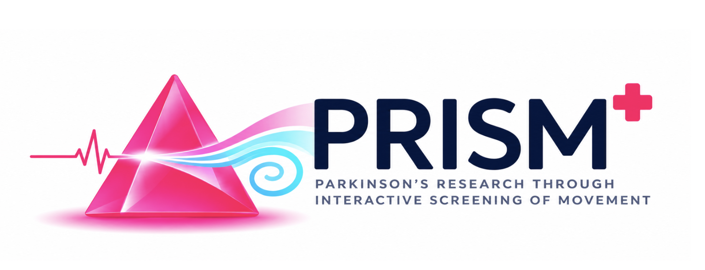

<p align="center"></p>

# PRISM

PRISM (Parkinson's Research through Interactive Screening of Movement) is a low-cost screening prototype for Parkinson's disease. It has two short tests: a person draws a spiral with a stylus, and taps their fingers in front of a small camera. Each test is compared with published data from people with and without Parkinson's.

Built at **natHacks 2026** (Healthcare & Accessibility track) by team **Ctrl Alt Delete**.

> **Screening prototype only. Not a clinical diagnosis.** A result is a prompt to talk to a clinician, nothing more.

## What it does

| Test | How it's done | What it measures | Compared with | Held-out result |
|---|---|---|---|---|
| **Spiral** | Trace a spiral with the S Pen on a tablet | Spiral deviation, pressure variability, tremor-band movement, uneven pen speed | 15 healthy / 61 Parkinson's recordings (UCI spiral dataset) | 83% accuracy (14/15 healthy, 49/61 Parkinson's), leave-one-out |
| **Finger tapping** | Tap thumb and index finger for 10 s per hand, filmed by a Raspberry Pi camera | Speed, tap size, size consistency, and how much taps shrink | 47 healthy / 53 Parkinson's people (Kasemsap et al. 2025) | AUC 0.91, sensitivity 92%, specificity 75%, leave-one-person-out |
| **Tapping severity band** | Same recording | How a neurologist would rate the tapping (MDS-UPDRS 3.4): "normal to slight" vs "mild or worse" | 489 neurologist-rated videos from 295 people (Islam et al. 2023) | AUC 0.79, leave-one-person-out |
| **Balance** *(planned)* | Stand still in front of the camera, 30 s eyes open then 30 s eyes closed | Side-to-side body sway | None yet: this is a planned study | Not a test. The recorder is built; data collection is the next step |

### How the scores work
- **Spiral (0–100).** Each of the four features is compared with the healthy and Parkinson's groups in the UCI data, and the evidence is combined into a probability that the drawing looks Parkinson's-like. A tremor frequency is shown but not scored. A tablet reads some features differently from the Wacom display the UCI data was recorded on, so pen input is calibrated using drawings from healthy team members on the same device (`01/calibration/`).
- **Finger tapping (0–100).** Logistic regression on each hand's tap count, mean tap size, tap-size variation and tap 1→10 drop, fitted on the Kasemsap data. The person's result is their **worse hand**. Bands come from the healthy group's held-out scores: **under 50 typical, 50–74 borderline, 75 or more elevated**. The features are computed the same way as in the paper (MediaPipe hand tracking, thumb-to-index distance as % of maximum).
- **Severity band.** A port of Islam et al.'s own feature code (wrist angle, first 10 taps), with a logistic regression on tapping speed variation and tap size. In their data these features track severity but **do not separate Parkinson's from controls**, so PRISM shows a band, never a diagnosis.

More detail: [`data/kasemsap_2025/README.md`](data/kasemsap_2025/README.md), [`data/islam_2023/README.md`](data/islam_2023/README.md), [`contract.json`](contract.json) (the spiral API and tablet calibration).

## Hardware

| Part | What we used | Notes |
|---|---|---|
| Laptop | Windows 11 | Runs the backend and the Wi-Fi hotspot |
| Tablet | Samsung Galaxy Tab S10 FE + S Pen | Opens the app in Chrome. Any browser works for a quick try |
| Camera | Raspberry Pi 4 + Camera Module V2 | Records at 40 fps and sends each clip to the laptop. A laptop webcam works as a fallback |

The Pi is taped to the laptop lid, upside down (`ROTATE=180` in `pi/drawdx-capture.service` turns the picture the right way up), and powered from the laptop's USB-C port. If `vcgencmd get_throttled` on the Pi reads anything other than `throttled=0x0`, use a 5 V / 3 A adapter instead.

## Setup (once)

1. **Python 3.13** (what we used). In the repo folder:
   ```bash
   pip install -r requirements.txt
   ```
2. **Tablet:** turn on USB debugging and install `adb`. See [`ADB_SETUP.md`](ADB_SETUP.md). `start_demo.ps1` looks for adb at `%USERPROFILE%\platform-tools\adb.exe`; pass `-Adb <path>` if yours is elsewhere.
3. **Raspberry Pi camera:** flash the SD card, install the capture service, focus the lens for 45 cm. See [`pi/SETUP.md`](pi/SETUP.md).
4. **Firewall (for the Pi):** in PowerShell **as Administrator**, run this once so only the hotspot (and an optional Ethernet cable) can reach the backend:
   ```powershell
   powershell -ExecutionPolicy Bypass -File tools\setup_firewall.ps1
   ```

## Running it

**Quick try, no hardware.** Start the backend and open <http://localhost:5000> in any browser. The spiral works with a mouse or touch, and **▶ Demo: Healthy** / **▶ Demo: PD** replay real recordings. The tapping test needs a camera.
```bash
python -m uvicorn server:app --app-dir 01 --port 5000
```

**Tablet over USB.** Plug in the tablet, then:
```powershell
powershell -ExecutionPolicy Bypass -File start_demo.ps1
```
Open `http://localhost:5000` in Chrome on the tablet. adb forwards the tablet's `localhost` to the laptop, which keeps the page a secure context so Chrome gives full-rate pen data.

**Full demo: wireless tablet + Pi camera.** Turn on the laptop's Mobile Hotspot (2.4 GHz, power saving off) and connect the tablet and the Pi to it. Venue Wi-Fi such as eduroam blocks devices from reaching each other.
```powershell
powershell -ExecutionPolicy Bypass -File start_demo.ps1 -Wireless -Pi
```
- The first time after the tablet restarts, plug it in by USB once. The script switches adb to Wi-Fi and you can unplug. After that it reconnects to the last tablet, or pass `-TabletIp <ip>`.
- The Pi appears in the **Tapping** tab ("Pi camera connected") within about 10 s of booting.
- A background watchdog checks the tablet link every 10 s and rebuilds it after a Wi-Fi blip. Its log is `%TEMP%\drawdx_tablet_watchdog.log`.

**Webcam fallback** (no Pi): add `-Webcam` instead of `-Pi`. The tablet screen is the same.

## Demo steps

1. **Spiral.** Tap **Begin Drawing**, trace the spiral with the S Pen in one stroke, then **Analyze Spiral**. You get a 0–100 score with a card for each feature. **Clear** starts over.
2. **Tapping.** Open the **Tapping** tab. Rest your forearm on the table with your hand on the mark, about 45 cm from the camera. Press **① Start right hand**. After the 3-2-1 countdown, tap index finger on thumb as fast and as big as you can until the bar finishes (10 s). Repeat with **② Start left hand**. You get a 0–100 score with a band, a result for each hand, and the severity band. **Clear and start over** resets it.
3. **Balance (planned).** The tab shows the study plan: why, who, protocol, what we'd measure, privacy, status. The working recorder sits in the closed **Try the recorder** drawer, for the team only; it turns on the camera only when opened.

## If something goes wrong

| Problem | Fix |
|---|---|
| Tablet can't open `localhost:5000` | Wait about 30 s for the watchdog. If it's still stuck, run `adb kill-server` and restart `start_demo.ps1` |
| "Camera not connected" in the Tapping tab | Was `start_demo.ps1` started with `-Pi`? Is the Pi on the hotspot? Did `tools\setup_firewall.ps1` run? From the Pi, `curl -s http://192.168.137.1:5000/health` should return `{"ok":true,...}` |
| Camera picture upside down | On the Pi, set `ROTATE` (0 or 180) in `/etc/systemd/system/drawdx-capture.service`, then `sudo systemctl daemon-reload && sudo systemctl restart drawdx-capture` |
| Old page on the tablet after an update | Refresh the page; assets are versioned (`?v=`) |

More fixes: [`ADB_SETUP.md`](ADB_SETUP.md) (tablet), [`pi/SETUP.md`](pi/SETUP.md) (Pi).

## Repo layout

| Path | What's there |
|---|---|
| `01/server.py` | FastAPI entry point: serves the page and includes the spiral, tapping and balance routes |
| `01/app.py`, `spiral_features.py`, `scoring.py`, `normalizer.py` | Spiral: feature extraction, scoring, tablet calibration |
| `01/hw_dataset/`, `01/new_dataset/` | UCI spiral reference recordings |
| `01/calibration/` | Healthy tablet drawings (Android, iPad) used for pen calibration |
| `01/tapping.py`, `tapping_analysis.py` | Tapping: talks to the camera, tracks the hand (MediaPipe), extracts features |
| `01/tapping_reference.py` / `.json` | Tapping score, built by `tools/build_tapping_reference.py` |
| `01/tapping_severity.py` / `.json` | Severity band, built by `tools/build_tapping_severity.py` |
| `balance/` | Balance study: pose tracking, sway features, recorder (backend and frontend) |
| `pi/` | Raspberry Pi capture service, focus helper, systemd unit and setup guide |
| `static/`, `templates/` | Tablet frontend (HTML, CSS, JavaScript) |
| `data/` | Finger-tapping reference datasets, with their licences and notes |
| `tablet_drawings/` | The first tablet calibration drawings |
| `start_demo.ps1` | One-command demo start (tablet link, watchdog, backend) |

Visitor recordings (`01/recordings/`) and balance study data (`balance/study_data/`) stay on the laptop and are excluded from git.

## Data and credits

- **Spiral:** Isenkul ME, Sakar BE, Kursun O. *Parkinson Disease Spiral Drawings Using Digitized Graphics Tablet*, UCI Machine Learning Repository (2014).
- **Finger tapping:** Kasemsap N. et al. *Screening for Parkinson's disease using "computer vision"*. PLOS ONE 20(8): e0330373 (2025). Data: [10.6084/m9.figshare.28883489.v3](https://doi.org/10.6084/m9.figshare.28883489.v3), CC BY 4.0.
- **Severity band:** Islam MS et al. *Using AI to measure Parkinson's disease severity at home*. npj Digital Medicine 6, 156 (2023). Data and code: [ROC-HCI/finger-tapping-severity](https://github.com/ROC-HCI/finger-tapping-severity), MIT.
- **Balance protocol:** de Oliveira et al., Frontiers in Neuroscience (2022); Santos & Duarte, PeerJ (2016). Camera method after Sonar et al., Sensors (2026).
- **Hand and body tracking:** Google MediaPipe.

## Limits

- Small reference groups: 15 healthy spiral recordings, 100 people for tapping. No result here has been tested on new patients.
- The reference data came from other devices (a Wacom display for the spiral, smartphones and webcams for tapping). We calibrated what we could and say so on screen.
- The tapping score uses tap speed, which also changes with age, effort and setup.
- Balance is a plan, not a test: there is no camera-based balance data from people with Parkinson's to compare against yet.

## Licence

Code: MIT (see [`LICENSE`](LICENSE)). The datasets keep their own licences (see `data/`).
